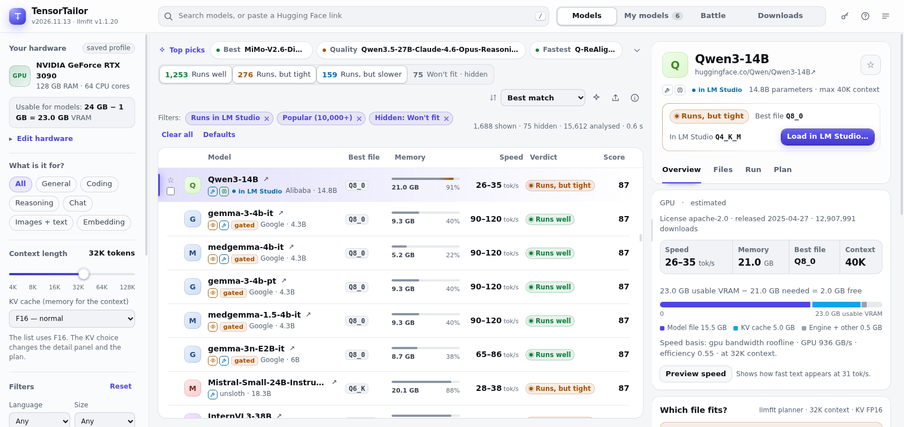
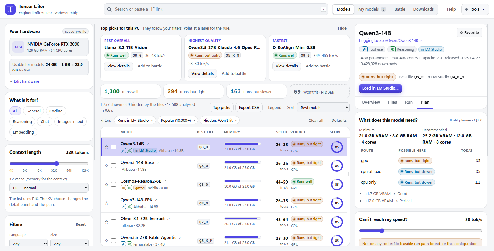
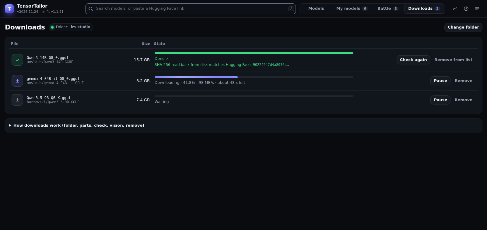

# TensorTailor

Find out which open AI models (LLMs) fit your PC, before you download them.

TensorTailor is **one HTML file** (about 3 MB). You open it in Edge or Chrome. It needs no install and works
offline. It checks about 19,000 models from Hugging Face against your GPU, VRAM, RAM and CPU. It tells you
which file to download, how fast the model will run, and which settings to use in LM Studio.

The calculation is the engine of [llmfit](https://github.com/AlexsJones/llmfit) by Alex Jones, inside the page
as WebAssembly. Every build checks that the page gives exactly the same answers as llmfit itself.

## What you can do with it

- **See what fits.** Every model gets a verdict for your PC: *Runs well*, *Runs, but tight*, *Runs, but
  slower* or *Won't fit*, with the expected speed in tokens per second and the memory it needs.
- **Pick the right file.** Tab **Files** shows the real GGUF files on Hugging Face, with size and SHA-256.
  A star (⭐) marks the file that suits your PC best.
- **Download safely.** Press **Download** next to a file. The file comes in parts, so after a crash you can
  resume. At the end TensorTailor reads the file back from disk and checks its SHA-256.
- **Load it in LM Studio.** Tab **Run** shows the LM Studio load settings for your PC. **Load in LM Studio with
  these settings** loads the model for you. You see what will be sent first.
- **Check your own models.** **My models** lists the models in LM Studio, how well they run here and the best
  setting. Give it LM Studio's models folder once, and it reads the header of each model file: layers, maximum
  context and MTP, like LM Studio itself shows them. LM Studio models that llmfit's list does not have are added
  by themselves (read live from Hugging Face, or made from LM Studio's own data), so the filter **Already in LM
  Studio** in Models shows all of them.
- **Keep favorites.** Click the star ☆ next to a model (or press `W`). **Only my favorites** shows just those,
  and My models shows the same stars.
- **Compare.** Tick 2 to 4 models and press **Compare**, or let them fight in **Battle**.
- **Stay up to date.** The catalog button (top right) → **Fetch new models** adds the newest models from
  Hugging Face. Or paste any Hugging Face link in the search box and press Enter.
- **Get help.** Point at a bar, speed, verdict or score for an explanation, or press `?` for the Help window.

## Get started

1. Open [Releases](https://github.com/jan-stegeman/tensortailor/releases) and download `tensortailor.html`.
2. Optional: check the download. In PowerShell, run `Get-FileHash .\tensortailor.html` and compare the result
   with `tensortailor.html.sha256` of the same release.
3. Open `tensortailor.html` in Edge or Chrome (double-click it, or drag it into the browser).
4. In **Your hardware** (left), press **Detect in browser**. Then type your VRAM and system RAM if they are
   not right. **Import…** copies the exact values from your PC with one PowerShell line.
5. Choose what the model is for (**What is it for?**, for example *Coding*). The list sorts itself.
6. Click a model. The panel on the right shows the details, the files, how to run it and a plan.
7. For LM Studio: start LM Studio and switch its server on (**Developer** tab → server on). TensorTailor then
   sees your models on `127.0.0.1:1234`.

A new release comes every Tuesday when something changed (a new llmfit version, a fresh model list, or a
change in the page).

## Screenshots

<picture>
  <source media="(prefers-color-scheme: dark)" srcset="docs/screenshots/models-dark.png">
  
</picture>

| | |
| --- | --- |
|  |  |
| **Files:** the real file list from Hugging Face, with SHA-256 | **Plan:** llmfit's planner for this PC |
|  |  |
| **My models:** your LM Studio models (demo data in this picture) | **Battle:** 2 to 4 models compete, one wins |
|  |  |
| **Downloads:** resume after a crash, SHA-256 read back from disk (demo data in this picture) | **Live check:** paste any Hugging Face link |

## Privacy

- No tracking, no account, nothing to install.
- The page talks only to `huggingface.co` (when you open a model's files, fetch new models or check a link)
  and to LM Studio on your own PC (`127.0.0.1:1234`).
- A Hugging Face token (only needed for gated models) stays in the browser tab. It is never saved in the file.
- Your settings, fetched models and download list stay in your browser on your PC.

## Good to know

- The verdicts and speeds are **estimates** from llmfit's formulas (or measured results, when llmfit has them
  for your GPU). Real speed depends on the program, its settings and the prompt.
- Downloads need Edge or Chrome (they use the browser's folder access). Pick LM Studio's models folder once;
  by default that is `C:\Users\<you>\.lmstudio\models`.
- LM Studio's API cannot set GPU offload and K/V cache quantization. When TensorTailor loads a model, LM Studio
  keeps its own setting for those two. The Run tab tells you what to set by hand.
- Models are never part of TensorTailor. Each model has its own license; some need you to accept terms on
  Hugging Face first.

## For developers

### How it is made

- **Engine:** llmfit-core, compiled to WebAssembly (`engine/`). Two small changes for the browser only:
  the clock in the recency bonus, and llmfit's update code split so the page can fetch from Hugging Face itself
  and then use llmfit's own conversion (`engine/tools/patch-llmfit.sh`).
- **Model list:** every Monday `.github/workflows/catalog.yml` runs llmfit's own scraper (same llmfit version as
  the engine) and stores a fresh catalog as the pre-release `catalog`, after llmfit's own checks. The Tuesday
  release uses it; if it is missing, old or failed, the release uses llmfit's own catalog. The release notes say
  which one. Rows that llmfit itself cannot read (for example a context of 100 billion tokens) are taken out and
  listed in the run summary.
- **Weekly release:** `.github/workflows/weekly.yml` follows new llmfit releases by itself: it switches the
  engine to the new llmfit tag, builds it, checks that the answers are the same as native llmfit, and only then
  commits and publishes. When a check fails, nothing is pushed or released.

### Build the page

```powershell
node web/build.mjs engine/pkg-nomod dist/tensortailor.html <path to llmfit hf_models.json>
```

`engine/pkg-nomod` is the `engine-wasm` artifact of a green `engine.yml` run (or your own Rust build).
GitHub Actions builds the page on every push (artifact `tensortailor-html`).

### Test it

`tools/cdp_test.mjs` opens the page in headless Edge through the DevTools protocol, runs test steps and saves
screenshots. Make the README pictures again after a change:

```powershell
$edge = "C:\Program Files (x86)\Microsoft\Edge\Application\msedge.exe"
$page = "file:///" + ((Resolve-Path "dist\tensortailor.html").Path -replace '\\', '/')
node tools/cdp_test.mjs $edge $page "$env:TEMP\tt-last.png" "state.ready && state.results.length > 0" tools/readme-screenshots.json
```

All pictures are 1600 × 900 and show the page in light and dark mode. The "My models" and "Downloads" pictures
use made-up demo data.

### Files

| Path | What it is |
| --- | --- |
| `engine/` | Rust crate that wraps llmfit-core and builds it to WebAssembly |
| `engine/tools/patch-llmfit.sh` | The two small browser changes to llmfit-core (clock, and the update code split) |
| `engine/tools/hf-fixtures.json` | 13 fixed Hugging Face models: the live conversion must be the same natively and in WebAssembly |
| `engine/about.toml`, `engine/about.hbs` | cargo-about settings: the licenses of the Rust crates in the engine |
| `web/app.html` | The real page (filled with the engine by `web/build.mjs`) |
| `web/build.mjs` | Makes the single file `dist/tensortailor.html` |
| `tools/cdp_test.mjs` | Tests the built page in headless Edge (DevTools protocol) and takes screenshots |
| `tools/test-sha256.mjs` | Checks the page's SHA-256 against Node's crypto and measures its speed |
| `tools/test-downloads.json` | Download test: pause, reload, resume, join, SHA-256, damaged file, remove (run with `CDP_SERVE_DIR`) |
| `tools/test-lms-load.json` | "Load in LM Studio" test: every load and unload is caught, nothing really loads |
| `tools/readme-screenshots.json` | The steps that make the README pictures (with demo data) |
| `docs/screenshots/` | The README pictures, light and dark |
| `.github/actions/build/` | The build steps, shared by both workflows |
| `.github/workflows/engine.yml` | GitHub build on every push: native and WebAssembly runs must give the same answers |
| `.github/workflows/weekly.yml` | Tuesday build: follows new llmfit releases and publishes a GitHub Release |
| `.github/workflows/catalog.yml` | Monday: fresh model catalog with llmfit's scraper (needs the `HF_TOKEN` secret, read only) |

## Credits and license

TensorTailor is under the MIT License (`LICENSE`). It is based on **llmfit**, Copyright (c) 2026 Alex Jones,
released under the MIT License. `THIRD-PARTY-NOTICES.md` lists everything else inside the page; the exact list
of Rust crates with their license texts is made at every build (About → **Show the licenses** in the page, and
`THIRD-PARTY-NOTICES.txt` with every release).
