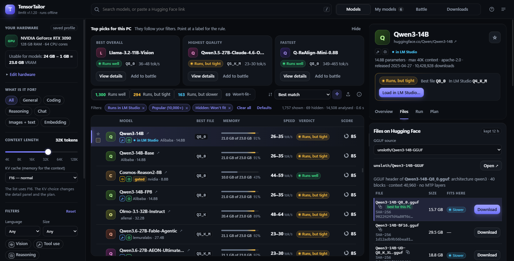
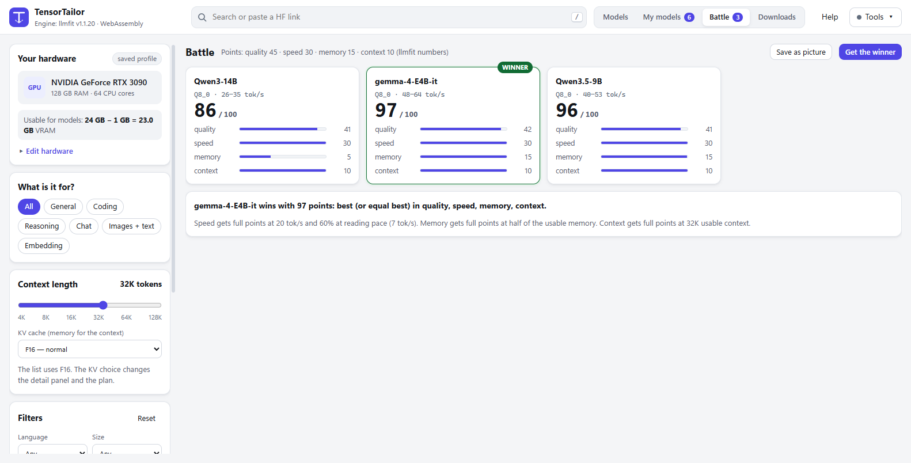
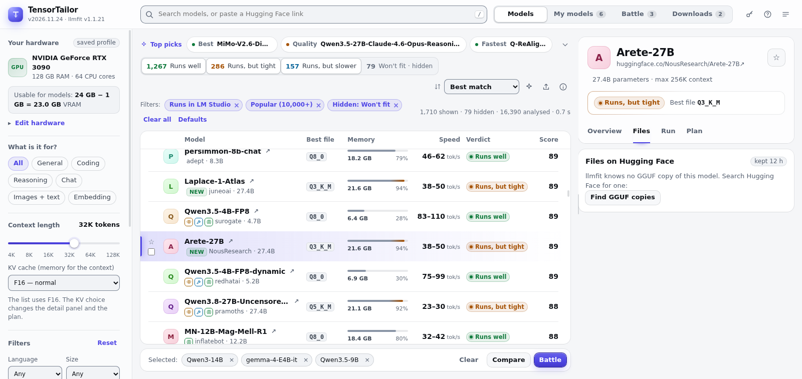
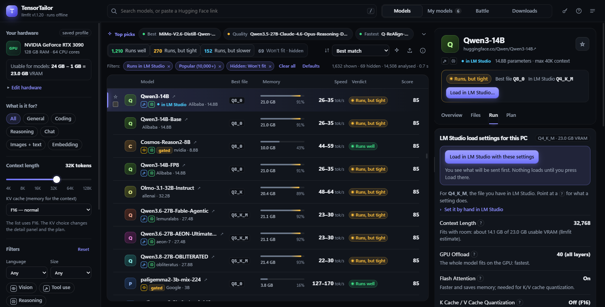
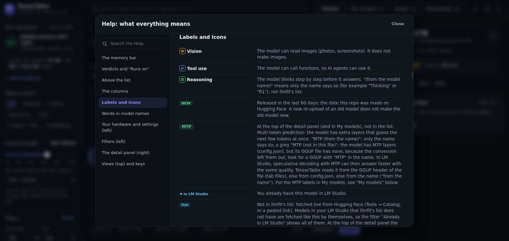

# TensorTailor

Find out which open AI models (LLMs) fit your PC, before you download them.

TensorTailor is **one HTML file** (about 3 MB). You open it in Edge or Chrome. It needs no install and works
offline. It checks about 19,000 models from Hugging Face against your GPU, VRAM, RAM and CPU. It tells you
which file to download, how fast the model will run, and which settings to use in LM Studio.

The calculation is the engine of [llmfit](https://github.com/AlexsJones/llmfit) by Alex Jones, inside the page
as WebAssembly. Every build checks that the page gives exactly the same answers as llmfit itself.

## What you can do with it

- **See what fits.** Every model gets a verdict for your PC: *Runs well*, *Runs, but tight*, *Runs, but
  slower* or *Won't fit*, with the expected speed in tokens per second and the memory it needs. The memory bar
  shows the part in VRAM in grey (with an amber end when VRAM is almost full) and the part that has to go to the
  slower system RAM as orange stripes. Repos with
  already-compressed weights in another format (EXL3, bnb-4bit, AWQ, GPTQ, MLX …) get the label *size uncertain*:
  LM Studio cannot load them as they are, and llmfit counts them too small.
- **Pick the right file.** Tab **Files** shows the real GGUF files on Hugging Face, with size and SHA-256.
  The green label **best for this PC** marks the file that suits your PC best.
- **Download safely.** Press **Download** next to a file. The file comes in parts, so after a crash you can
  resume. The SHA-256 of the parts is checked before the file gets its name, so a damaged download never shows up
  in LM Studio; at the end TensorTailor reads the file back from disk and checks it again, and only then removes the
  parts. If the joined file differs, it is removed and joined once more from the checked parts, so a damaged file
  never stays in LM Studio's folder. For a file that was already there and differs, **Download again** deletes it
  (after you confirm) and downloads it anew. Another file with the same name is never overwritten.
- **Load it in LM Studio.** Tab **Run** shows the LM Studio load settings for your PC. **Load in LM Studio with
  these settings** loads the model for you. You see what will be sent first.
- **Check your own models.** **My models** lists the models in LM Studio, how well they run here, the speed of
  your own file (llmfit's estimate scaled to its size) and the best setting (the same advice as tab Run). Give it LM Studio's models folder once, and it reads the header of each model file: layers, maximum
  context and MTP, like LM Studio itself shows them, and the size of the KV cache (the memory for the context). LM Studio models that llmfit's list does not have are added
  by themselves (read live from Hugging Face, or made from LM Studio's own data), so the filter **Already in LM
  Studio** in Models shows all of them. For a model made from LM Studio's data no Hugging Face page is known, so its
  ↗ link searches Hugging Face for the name. It also asks Hugging Face once a day whether each model file changed there
  (**update available**, with a link to what changed); **Check SHA-256** compares your file exactly. Below the list,
  **Similar models and disk space** groups models made from the same base model (for example three versions of one
  27B model, 53 GB) and shows how much space keeping one of them would free. Nothing is replaced or deleted.
- **Measure the real speed.** Press **Measure** next to a model that is loaded in LM Studio: LM Studio writes about
  256 tokens and TensorTailor shows the measured speed next to the estimate. Your measurements also correct the
  estimates of other models for your PC ("your PC: ~A–B" in the detail panel). Measure never loads a model.
- **Keep favorites.** Click the star ☆ next to a model (or press `W`). **Only my favorites** shows just those,
  and My models shows the same stars.
- **Know what a name means.** Many models are changed copies of a known model: *abliterated*, *Heretic*,
  *uncensored*, *base*, *distill*, *merge* … The Overview tab says what such a word in the name means (**Name
  says**), and the Help part **Words in model names** explains them all, with the good and bad sides of the
  "uncensored" versions. The filter **Hide uncensored versions** hides models whose name says so.
- **Compare.** Tick 2 to 4 models and press **Compare**, or let them fight in **Battle**.
- **Stay up to date.** **Tools** (top right) → **Catalog** → **Fetch new models** adds the newest models from
  Hugging Face. Or paste any Hugging Face link in the search box and press Enter.
- **Get help.** Point at a bar, speed, verdict or score for an explanation, or press `?` for the Help window.

## Get started

1. Open [Releases](https://github.com/jan-stegeman/tensortailor/releases) and download `tensortailor.html`.
2. Optional: check the download. In PowerShell, run `Get-FileHash .\tensortailor.html` and compare the result
   with `tensortailor.html.sha256` of the same release.
3. Open `tensortailor.html` in Edge or Chrome (double-click it, or drag it into the browser). Its version is at the
   top left, under the name (for example `v2026.11.17`; a second release on one day is `v2026.11.17-2`). Compare it
   with the newest release on the Releases page to know that you have the latest.
4. In **Your hardware** (left), press **Detect in browser**: it fills in your GPU and its VRAM. The browser cannot
   tell your system RAM and CPU cores, so type those if they are not right. Or use **Import…**: one PowerShell line
   copies the exact values from your PC (also the free space on the drive with LM Studio's models folder).
5. Choose what the model is for (**What is it for?**, for example *Coding*). The list sorts itself.
6. Click a model. The panel on the right shows the details, the files, how to run it and a plan.
7. For LM Studio: start LM Studio and switch its server on (**Developer** tab → server on). TensorTailor then
   sees your models on `127.0.0.1:1234`.

A new release comes every Tuesday when something changed (a new llmfit version, a fresh model list, or a
change in the page).

## Screenshots

<picture>
  <source media="(prefers-color-scheme: dark)" srcset="docs/screenshots/models-dark.png">
  
</picture>

| | |
| --- | --- |
|  |  |
| **Files:** the real file list from Hugging Face, with SHA-256 | **Plan:** llmfit's planner for this PC |
|  |  |
| **My models:** your LM Studio models (demo data in this picture) | **Battle:** 2 to 4 models compete, one wins |
|  |  |
| **Downloads:** resume after a crash, SHA-256 read back from disk (demo data in this picture) | **Live check:** paste any Hugging Face link |
|  |  |
| **Run:** what to set in LM Studio, or let TensorTailor load it (demo data) | **Help:** every label, icon, filter and view explained |

## Privacy

- No tracking, no account, nothing to install.
- The page talks only to Hugging Face and to LM Studio on your own PC (`127.0.0.1:1234`). Hugging Face
  (`huggingface.co`, and its download servers for files): when you open a model (gated check, file list, GGUF
  header, `config.json`), check a link, fetch new models or download a file, and by itself in My models (the base
  models for Similar, the daily update check).
- A Hugging Face token (only needed for gated models) stays in the browser tab. It is never saved in the file.
  Set it with the key button at the top right; the key turns green when a token is set.
  The page carries Hugging Face's list of gated models from its build day (fresh every weekly release), and a model
  you open is checked live: the label says **gated** (token needed) or **license** in grey (own terms, no token
  needed). The filter **No token needed** hides the gated models.
- Your settings, fetched models and download list stay in your browser on your PC.

## Good to know

- The verdicts and speeds are **estimates** from llmfit's formulas (or measured results from llmfit's own
  community data, when it has them for your GPU). Real speed depends on the program, its settings and the
  prompt: **Measure** in My models shows the real speed on your PC.
- Downloads need Edge or Chrome (they use the browser's folder access). Pick LM Studio's models folder once;
  by default that is `C:\Users\<you>\.lmstudio\models`.
- LM Studio's API cannot set GPU offload and K/V cache quantization. When TensorTailor loads a model, LM Studio
  keeps its own setting for those two. The Run tab tells you what to set by hand.
- Models are never part of TensorTailor. Each model has its own license; some need you to accept terms on
  Hugging Face first.
- **No warranty.** The verdicts, speeds and settings are estimates, and you download and run models at your own
  risk. What a model writes, and how you use it, is your own responsibility (also for "uncensored" versions).
  See `LICENSE` (MIT).
- Found a problem or have an idea? Open a [new issue](https://github.com/jan-stegeman/tensortailor/issues/new/choose)
  and pick a form. Want to help with the code? See [CONTRIBUTING.md](CONTRIBUTING.md). Keyboard, screen readers
  and contrast: see [ACCESSIBILITY.md](ACCESSIBILITY.md).
- Found a security problem? See [SECURITY.md](SECURITY.md).

## For developers

### How it is made

- **Engine:** llmfit-core, compiled to WebAssembly (`engine/`). Two small changes for the browser only:
  the clock in the recency bonus, and llmfit's update code split so the page can fetch from Hugging Face itself
  and then use llmfit's own conversion (`engine/tools/patch-llmfit.sh`). One data change: llmfit's cache of
  benchmark results from localmaxxing.com is left out (`engine/tools/strip-benchmark-cache.sh`), because their
  terms give no license for the data; llmfit's own community results (MIT) stay in. And one small addition:
  for the about 4,900 models in llmfit's list without layer data, the engine fills in the KV cache values from a
  real GGUF header that the page has read (`setExtraModelsAndFills`: never a value llmfit has, never when the
  file disagrees), so the memory for the context is exact instead of a rough rule.
- **Model list:** every Monday `.github/workflows/catalog.yml` runs llmfit's own scraper (same llmfit version as
  the engine) and stores a fresh catalog as the pre-release `catalog`, after llmfit's own checks. The Tuesday
  release uses it; if it is missing, old or failed, the release uses llmfit's own catalog. The release notes say
  which one. Rows that llmfit itself cannot read (for example a context of 100 billion tokens) are taken out and
  listed in the run summary. The engine merges re-uploads of the same model into one row and keeps the newest
  date of them all, so `web/build.mjs` also stores each repo's own release date (and the number of catalog rows)
  from the catalog file; the page shows that date ("released", NEW).
- **Weekly release:** `.github/workflows/weekly.yml` follows new llmfit releases by itself: it switches the
  engine to the new llmfit tag, builds it, checks that the answers are the same as native llmfit, and only then
  commits and publishes. When a check fails, nothing is pushed or released.

### Build the page

```powershell
node web/build.mjs engine/pkg-nomod dist/tensortailor.html <path to llmfit hf_models.json>
```

`engine/pkg-nomod` is the `engine-wasm` artifact of a green `engine.yml` run (or your own Rust build).
GitHub Actions builds the page on every push (artifact `tensortailor-html`).

### Test it

`tools/cdp_test.mjs` opens the page in headless Chrome (or Edge) through the DevTools protocol, runs test steps
and saves screenshots. Make the README pictures again after a change:

```powershell
$chrome = "C:\Program Files\Google\Chrome\Application\chrome.exe"
$page = "file:///" + ((Resolve-Path "dist\tensortailor.html").Path -replace '\\', '/')
node tools/cdp_test.mjs $chrome $page "$env:TEMP\tt-last.png" "state.ready && state.results.length > 0" tools/readme-screenshots.json
```

The built-in Help must stay complete: `web/build.mjs` runs `web/help-check.mjs` first, and the build stops when a
filter, view, sort choice or label of the page has no row in the Help.

All pictures are 1600 × 900 and show the page in light and dark mode. The "My models" and "Downloads" pictures
use made-up demo data.

### Files

| Path | What it is |
| --- | --- |
| `engine/` | Rust crate that wraps llmfit-core and builds it to WebAssembly |
| `engine/tools/patch-llmfit.sh` | The two small browser changes to llmfit-core (clock, and the update code split) |
| `engine/tools/strip-benchmark-cache.sh` | Leaves llmfit's localmaxxing.com benchmark cache out (browser copy and golden copy) |
| `engine/tools/hf-fixtures.json` | 13 fixed Hugging Face models: the live conversion must be the same natively and in WebAssembly |
| `engine/about.toml`, `engine/about.hbs` | cargo-about settings: the licenses of the Rust crates in the engine |
| `web/app.html` | The real page (filled with the engine by `web/build.mjs`) |
| `web/build.mjs` | Makes the single file `dist/tensortailor.html` |
| `web/help-check.mjs` | Stops the build when the Help misses a filter, view, sort choice or label |
| `tools/fetch-gated.mjs` | Hugging Face's list of gated models, for the "gated" labels (run by the build action) |
| `tools/cdp_test.mjs` | Tests the built page in headless Chrome or Edge (DevTools protocol) and takes screenshots |
| `tools/test-sha256.mjs` | Checks the page's SHA-256 against Node's crypto and measures its speed |
| `tools/test-downloads.json` | Download test: pause, reload, resume, join, SHA-256, damaged file, Download again, parts check, no overwrite, remove (run with `CDP_SERVE_DIR`) |
| `tools/test-review2.json` | The fixes of the second review: GGUF header values as data, release dates, memory labels at every width, config.json requests, hardware import, Run commands, KV choice, file matching, Measure |
| `tools/test-name-words.json` | Words in model names: which names get a "Name says" line, the filter "Hide uncensored versions", the Help link |
| `tools/test-help-audit.json` | The Help audit of 2026-11-13: memory bar to scale with orange stripes, and the Help texts that were fixed or added |
| `tools/test-screen-review.json` | The screen review before going public (1366 × 768): the panel's drag line on its edge, the list keeps all its columns, sizes and memory labels never cut, long names, file names, the "Selected:" strip, My models while measuring, Downloads sizes |
| `tools/test-store-safety.json` | Saved data in the browser: a fetched model the engine cannot read is kept (not erased) and the others stay in the list; wrong saved hardware values fall back to the start values; a full storage is said; plain words when a file cannot be deleted |
| `tools/test-review3-w.json` | Points of the third review: a measured speed (llmfit's community results) is the speed shown, the formula estimate stays in the tooltip; the drag line tells screen readers its width; no download starts while Check again or Download again waits, and a file another tab works on is left waiting; the "in LM Studio" check gives the same answers with its short memo; moving fast through the list asks Hugging Face only about the model you stop on, and a GGUF header read stops when you move on; the review of these fixes: Pause, Remove, Check again and Download again respect the lock and each other, a job another tab finished is not downloaded again, "your PC" scales llmfit's formula also for measured rows, the drag line values stay right after a reset or another view |
| `tools/test-lms-load.json` | "Load in LM Studio" test: every load and unload is caught, nothing really loads |
| `tools/run-all-tests.ps1` | Builds the page, checks that the repo is ready to be public (no private text, keys or own paths in the files, their history or the page; every workflow action pinned to a commit), and runs every test above in headless Chrome (`-Readme` also makes the README pictures) |
| `tools/test-key.json` | The token key in the header: grey without a token, green with one, a click opens the token window |
| `tools/test-kv-fill.json` | KV cache fields from a GGUF header for rows of llmfit's list without layer data (Files tab and My models); exact rows untouched |
| `tools/test-measure.json` | Measure in My models with a made-up LM Studio: warm-up + measured run, never a load, the factor for this PC |
| `tools/test-groups.json` | Similar models in My models: made-up files under real repo names, Hugging Face's base models, the file-header fallback (run with `CDP_SERVE_DIR`) |
| `tools/test-updates.json` | Update check in My models: a real 1.2 MB GGUF and made-up files in test storage, Hugging Face's paths-info, SHA-256 (run with `CDP_SERVE_DIR`) |
| `tools/readme-screenshots.json` | The steps that make the README pictures (with demo data) |
| `docs/screenshots/` | The README pictures, light and dark |
| `.github/actions/build/` | The build steps, shared by both workflows |
| `.github/workflows/engine.yml` | GitHub build on every push: native and WebAssembly runs must give the same answers |
| `.github/workflows/weekly.yml` | Tuesday build: follows new llmfit releases and publishes a GitHub Release |
| `.github/workflows/catalog.yml` | Monday: fresh model catalog with llmfit's scraper (needs the `HF_TOKEN` secret, read only) |
| `.github/dependabot.yml` | Monthly updates of the GitHub Actions (those of other authors are pinned to a commit) |
| `.github/ISSUE_TEMPLATE/` | The forms for a new issue: bug report, wrong fit/speed/memory, feature request, accessibility barrier |
| `.github/pull_request_template.md` | The text a new pull request starts with: what changed, how it was tested, a checklist |
| `CONTRIBUTING.md` | How to report a problem and how to send a pull request |
| `ACCESSIBILITY.md` | What works with keyboard, screen readers and contrast, how it was tested, the known limits |
| `SECURITY.md` | How to report a security problem privately |

## Credits and license

TensorTailor is under the MIT License (`LICENSE`). It is based on **llmfit**, Copyright (c) 2026 Alex Jones,
released under the MIT License. `THIRD-PARTY-NOTICES.md` lists everything else inside the page; the exact list
of Rust crates with their license texts is made at every build (About → **Show the licenses** in the page, and
`THIRD-PARTY-NOTICES.txt` with every release).
