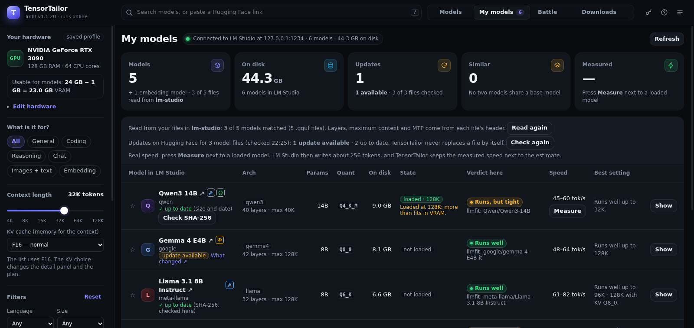

# TensorTailor

Find out which open AI models (LLMs) fit your PC, before you download them.

TensorTailor will be **one HTML file**. You open it in Edge or Chrome. It needs no install and works
offline. It checks about 19,000 models from Hugging Face against your GPU, VRAM, RAM and CPU, and it
tells you which file to download and how fast it will run.

> **Status:** first working version. `dist/tensortailor.html` is one offline file (about 3 MB) with the llmfit
> engine inside as WebAssembly. Every build checks that the engine gives exactly the same answers as native
> llmfit. Direct downloads inside the page are not done yet.

## Get the page

Open [Releases](https://github.com/jan-stegeman/tensortailor/releases), download `tensortailor.html`, and open it
in Edge or Chrome. Each release also has `tensortailor.html.sha256` to check the download.

A new release comes every Tuesday when something changed. The weekly build (`.github/workflows/weekly.yml`)
also follows new llmfit releases by itself: it switches the engine to the new llmfit tag, builds it, checks
that the answers are the same as native llmfit, and only then commits and publishes. When a check fails,
nothing is pushed or released.

## Screenshots

<picture>
  <source media="(prefers-color-scheme: dark)" srcset="docs/screenshots/models-dark.png">
  
</picture>

| | |
| --- | --- |
|  |  |
| **Files:** the real file list from Hugging Face, with SHA-256 | **Plan:** llmfit's planner for this PC |
|  |  |
| **My models:** your LM Studio models (demo data in this picture) | **Battle:** 2 to 4 models compete, one wins |
|  |  |
| **Downloads:** resume after a crash, SHA-256 read back from disk (demo data in this picture) | **Live check:** paste any Hugging Face link |

All pictures are 1600 × 900 and show the page in light and dark mode. The "My models" pictures use
made-up demo models, not a real LM Studio list. Make them again after a change:

```powershell
node tools/cdp_test.mjs "C:\Program Files (x86)\Microsoft\Edge\Application\msedge.exe" "file:///D:/AI/tools/llmfit-studio/dist/tensortailor.html" D:\AI\temp\tt-last.png "state.ready && state.results.length > 0" tools/readme-screenshots.json
```

## Build the page

```powershell
node web/build.mjs engine/pkg-nomod dist/tensortailor.html <path to llmfit hf_models.json>
```

GitHub Actions builds it on every push (artifact `tensortailor-html`).

## What is here now

| Path | What it is |
| --- | --- |
| `design/mockup.html` | Clickable design with example data (open it in Edge or Chrome) |
| `design/mockup-dark.png` | Screenshot of the design: model list (dark) |
| `design/mockup-battle-light.png` | Screenshot of the design: Battle view (light) |
| `research/similar-tools.md` | Study of similar tools and the features we take over |
| `PROGRESS.md` | Decisions, what is done, and the next steps |
| `engine/` | Rust crate that wraps llmfit-core and builds it to WebAssembly |
| `engine/tools/patch-llmfit.sh` | The two small browser changes to llmfit-core (clock, and the update code split) |
| `engine/tools/hf-fixtures.json` | 13 fixed Hugging Face models: the live conversion must be the same natively and in WebAssembly |
| `web/app.html` | The real page (filled with the engine by `web/build.mjs`) |
| `web/build.mjs` | Makes the single file `dist/tensortailor.html` |
| `tools/cdp_test.mjs` | Tests the built page in headless Edge (DevTools protocol) and takes screenshots |
| `tools/test-sha256.mjs` | Checks the page's SHA-256 against Node's crypto and measures its speed |
| `tools/test-downloads.json` | Download test: pause, reload, resume, join, SHA-256, damaged file, remove (run with `CDP_SERVE_DIR`) |
| `tools/readme-screenshots.json` | The steps that make the README pictures (with demo data for My models) |
| `docs/screenshots/` | The README pictures, light and dark |
| `.github/actions/build/` | The build steps, shared by both workflows |
| `.github/workflows/engine.yml` | GitHub build on every push: native and WebAssembly runs must give the same answers |
| `.github/workflows/weekly.yml` | Tuesday build: follows new llmfit releases and publishes a GitHub Release |
| `.github/workflows/catalog.yml` | Monday: fresh model catalog with llmfit's scraper (needs the `HF_TOKEN` secret, read only) |

## How it will work

- **Engine:** the fit and speed calculation of [llmfit](https://github.com/AlexsJones/llmfit) by Alex Jones,
  compiled to WebAssembly so it runs inside the browser. The results match llmfit.
- **Model list:** every Monday `.github/workflows/catalog.yml` runs llmfit's own scraper (same llmfit version as
  the engine) and stores a fresh catalog as the pre-release `catalog`, after llmfit's own checks. The Tuesday
  release uses it; if it is missing, old or failed, the release uses llmfit's own catalog. The release notes say
  which one. Rows that llmfit itself cannot read (for example a context of 100 billion tokens) are taken out and
  listed in the run summary.
- **New models:** click the catalog button (top right), then **Fetch new models**. Like `llmfit update`, it adds
  the newest trending and most downloaded models from Hugging Face, with llmfit's own code inside the engine.
  Or paste any Hugging Face link in the search box and press Enter to check one model live. Searching for a
  publisher (for example HauhauCS) shows how many matches your filters hide, and **Search Hugging Face** adds the
  publisher's models. Fetched models
  get the label **live** and stay in your browser until you remove them.
- **Your hardware:** the browser sees the GPU name and CPU threads; you type or import RAM and VRAM.
- **Downloads:** press **Download** next to a file (tab **Files**). Pick a folder once, best LM Studio's models
  folder: the file goes to `<folder>\<publisher>\<repo>\`. It comes in parts of 256 MB, so after a crash or
  restart **Resume** keeps the finished parts. The model file gets its real name only when it is complete.
  Then TensorTailor reads it back from disk and compares its SHA-256 with Hugging Face's. Edge or Chrome only.
- **MTP (multi-token prediction):** the detail panel shows if a model has MTP layers, read from the GGUF header
  of the file (Range requests), else from `config.json`, else from the name. My models shows if LM Studio uses it.
- **Help:** point at a bar, speed, verdict or score for an explanation, or press `?` for the Help window.
- **LM Studio:** reads your local models and can measure real speed through LM Studio's local server.

## Credits and license

TensorTailor is based on **llmfit**, Copyright (c) 2026 Alex Jones, released under the MIT License.
The license of TensorTailor itself is chosen before the first public release.
